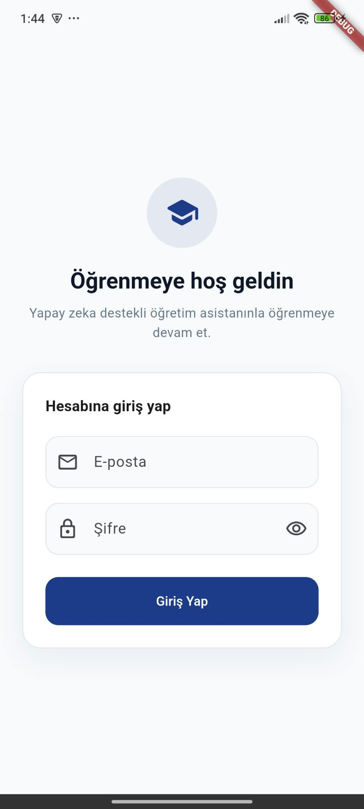
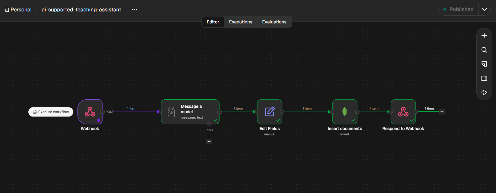
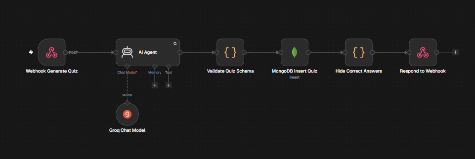
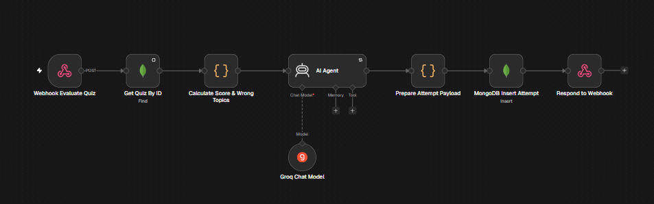

# Akıllı Ders Asistanı (Smart Course Assistant)

Yapay zeka destekli, **Flutter**, **n8n** iş akışları, **Ollama** (yerel LLM - `qwen2.5:3b`) ve **MongoDB** tabanlı uçtan uca akıllı ders ve soru-cevap asistanı.

---

## Proje Yapısı

- `frontend/` — Flutter mobil ve masaüstü arayüzü (`LoginScreen`, `ChatScreen` ve ağ servisleri)
- `screenshots/` — Uygulama arayüzü ve n8n iş akışı ekran görüntüleri
- `ai-supported-teaching-assistant.json` — Dışa aktarılan n8n iş akışı (Webhook → Ollama → MongoDB)
- `docker-compose.yml` — n8n, Ollama ve MongoDB servis yapılandırmaları
- `start-ai.bat` — Docker servislerini ve yerel yapay zeka modelini başlatan otomasyon betiği

---

## Ekran Görüntüleri

### Mobil Arayüz (Flutter)

| Giriş Ekranı | Sohbet & Soru-Cevap Ekranı |
| :---: | :---: |
|  |  |

---

## n8n Otomasyon İş Akışları

Tüm yapay zeka işlemleri n8n üzerindeki webhook tabanlı iş akışlarıyla yürütülür. Model çağrıları yerel **Ollama** (`qwen2.5:3b`), kalıcı veriler **MongoDB** üzerinden yönetilir.

| İş Akışı | Endpoint (POST) | Görevi | MongoDB Koleksiyonu |
| :--- | :--- | :--- | :--- |
| ai-supported-teaching-assistant | `/webhook/ask` | Soru-cevap ve sohbet geçmişi | `chat_history` |
| Summarize Course Notes | `/webhook/summarize` | Ders notunu özetler | `sources` |
| Generate Quiz | `/webhook/generate-quiz` | Metinden 5 çoktan seçmeli soru üretir | `quizzes` |
| Evaluate Quiz | `/webhook/evaluate` | Puanlar ve yapay zekâ ile çalışma önerisi üretir | `quiz_attempts` |
| Submit Quiz | `/webhook/evaluate` | Yapay zekâsız hızlı puanlama | — |

### 1. Soru-Cevap (ai-supported-teaching-assistant)

Webhook → Message a model (Ollama) → Edit Fields → Insert documents (MongoDB) → Respond to Webhook



Flutter sohbet ekranından gelen soru Türkçe yanıtlanır; soru ve yanıt `chat_history` koleksiyonuna kaydedilir.

### 2. Ders Notu Özetleme (Summarize Course Notes)

Webhook → Message a model (Ollama) → Prepare Source Document → MongoDB Insert Source → Respond to Webhook


Gelen ders notu kısa bir özet ve "Anahtar Kavramlar" listesi olarak özetlenir. Not, özet ve oluşturulma zamanı `sources` koleksiyonuna kaydedilir; yanıt olarak `source_id` ve özet döner.

### 3. Otomatik Test Oluşturma (Generate Quiz)

Webhook → Ollama Generate Quiz → Validate Quiz Schema → MongoDB Insert Quiz → Hide Correct Answers → Respond to Webhook



Ders notundan 5 çoktan seçmeli soru üretilir. Modelin JSON çıktısı kod node'u ile temizlenip doğrulanır, `quizzes` koleksiyonuna kaydedilir. Uygulamaya dönen yanıttan doğru cevaplar çıkarılır.

### 4. Performans Değerlendirme (Evaluate Quiz)

Webhook → Get Quiz By ID → Calculate Score & Wrong Topics → Basic LLM Chain (Ollama Study Advice) → Prepare Attempt Payload → MongoDB Insert Attempt → Respond to Webhook



Öğrencinin cevapları MongoDB'deki test ile karşılaştırılır; puan, doğru/yanlış sayısı ve yanlış sorular hesaplanır. Yanlışlara göre Ollama kişiselleştirilmiş bir çalışma önerisi üretir ve sonuç `quiz_attempts` koleksiyonuna kaydedilir.

### 5. Hızlı Puanlama (Submit Quiz)

Webhook → MongoDB Find Quiz → Grade Quiz → Respond to Webhook


Yapay zekâ kullanmayan, daha hafif puanlama akışıdır. Testi bulur, cevapları kontrol eder ve puanı döndürür.

---

## Kurulum ve Çalıştırma

### 1. Altyapı Servislerini Başlatma (Docker)

Proje kök dizininde Docker konteynerlerini (`n8n`, `ollama`, `mongodb`) ayağa kaldırın veya `start-ai.bat` dosyasını çalıştırın:

```bash
docker compose up -d
```

### 2. n8n İş Akışlarını İçe Aktarma

n8n arayüzünde (`http://localhost:5678`) iş akışı JSON dosyalarını **Import from File** ile içe aktarın ve her birini **Publish** edin. MongoDB ve Ollama credential'larını kendi ortamınıza göre tanımlayın.

### 3. Flutter Uygulamasını Çalıştırma

```bash
cd frontend
flutter pub get
flutter run
```