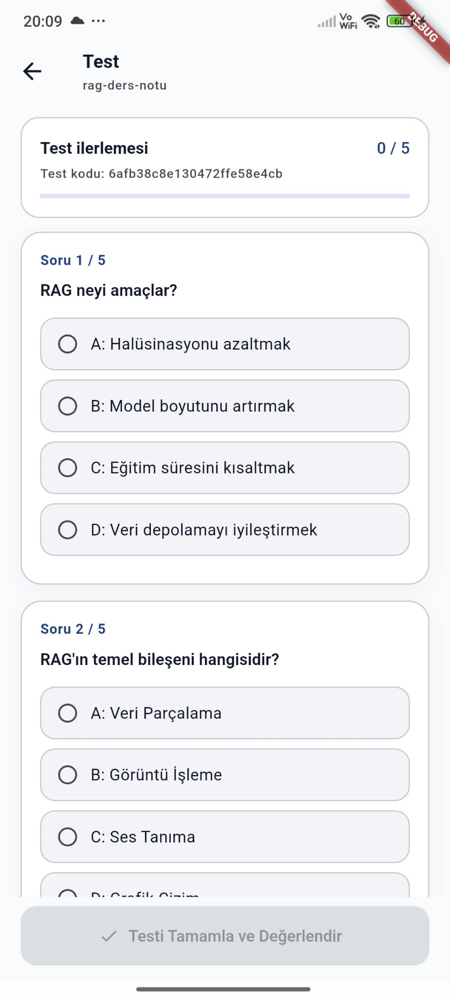
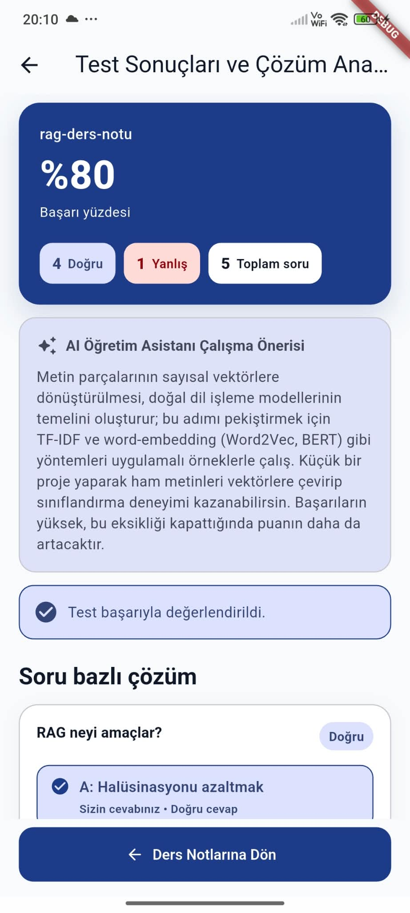
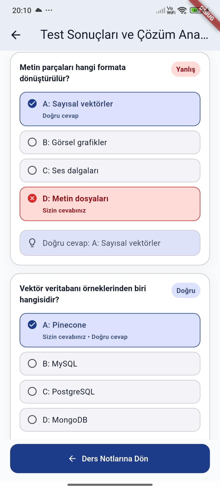
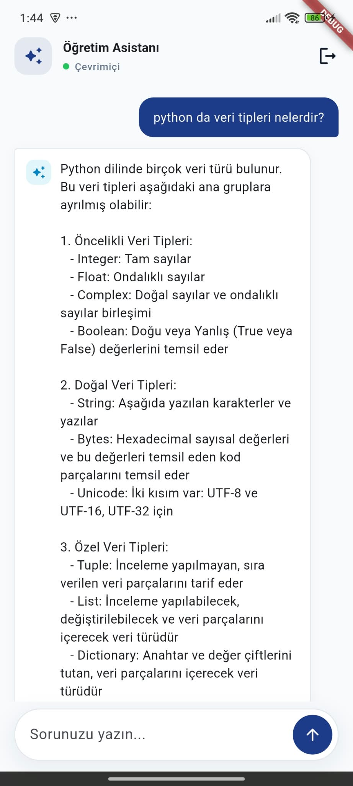
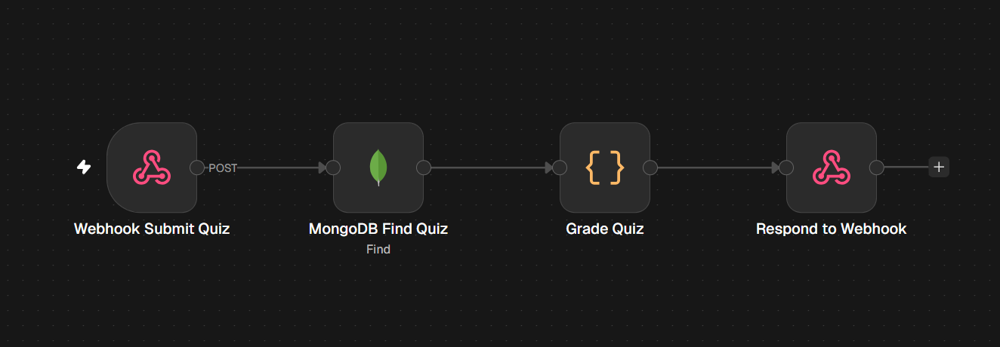

# Akıllı Ders Asistanı (Smart Course Assistant)

Yapay zeka destekli, **Flutter**, **n8n** iş akışları, **Groq** (bulut LLM API) ve **MongoDB** tabanlı uçtan uca akıllı ders ve soru-cevap asistanı. Ders notlarını özetler, quiz üretir, quizleri değerlendirir ve yanlış konulara göre geri bildirim verir.

Yapay zeka destekli iş akışlarında **Groq Chat Model** kullanılır.

---

## Proje Yapısı

- `frontend/` — Flutter mobil ve masaüstü arayüzü
- `screenshots/` — Uygulama arayüzü ve n8n iş akışı ekran görüntüleri
- `docker-compose.yml` — n8n ve MongoDB servis yapılandırmaları
- `start-ai.bat` — Docker servislerini başlatan otomasyon betiği

---

## Mimari

```text
Flutter App  →  n8n Webhook  →  Groq LLM (AI Agent)  →  MongoDB  →  Flutter App
```

| Bileşen | Görev |
| :-- | :-- |
| **Flutter** | Kullanıcı arayüzü (ders listesi, ders notları, test, öğretim asistanı) |
| **n8n** | Webhook tabanlı iş akışları ve orkestrasyon |
| **Groq** | Hızlı bulut LLM çıkarımı (özet, quiz üretimi, değerlendirme) |
| **MongoDB** | Quiz ve deneme (attempt) kayıtlarının saklanması |
| **Docker** | n8n ve MongoDB servislerinin çalıştırılması |

---

## Ekran Görüntüleri

### Ana Sayfa

Kullanıcının ders notları tek yerde listelenir. Başlığa göre arama yapılabilir, notlar **Özetlenenler** ve **Testi Çözülenler** filtreleriyle ayrılabilir. **Devam Et** kartı en son çalışılan derse hızlı dönüş sağlar.

<!-- markdownlint-disable MD033 -->
<p align="center">
  
</p>

### Ders Notu Ekleme, Özetleme ve Test Oluşturma

Kullanıcı ders başlığını ve not metnini yazabilir ya da **TXT Dosyası Seç** ile bir dosya yükleyebilir. Ardından notu **Özetle** veya **Test Oluştur** butonlarıyla işleyebilir.

| 1. Boş Form | 2. Not Yüklenmiş | 3. Yapay Zeka Özeti |
| :---: | :---: | :---: |
|  |  |  |

### Test Çözme ve Sonuçlar

Ders notundan üretilen çoktan seçmeli test çözülür. Test bitince başarı yüzdesi, doğru ve yanlış sayısı ile yapay zeka öğretim asistanının yanlış yapılan konulara göre hazırladığı **çalışma önerisi** gösterilir. Aşağıda her soru için verilen cevap ve doğru cevap ayrıntılı olarak incelenebilir.

| 1. Test Ekranı | 2. Sonuç ve Çalışma Önerisi | 3. Soru Bazlı Çözüm Analizi |
| :---: | :---: | :---: |
|  |  |  |

### Öğretim Asistanı

Kullanıcı derslerle ilgili serbest sorular sorabilir veya örnek sorulardan biriyle başlayabilir.

| Karşılama Ekranı | Soru-Cevap |
| :---: | :---: |
|  |  |
<!-- markdownlint-enable MD033 -->

---

## n8n Otomasyon İş Akışları

Projede beş ana iş akışı vardır. Yapay zeka gerektiren akışlarda **AI Agent + Groq Chat Model** kullanılır.

### 1. Ders Notu Özetleme

Kullanıcının gönderdiği ders notunu Groq modeliyle özetler.


### 2. Quiz Üretme

`Webhook` → `AI Agent (Groq)` → `Validate Quiz Schema` → `MongoDB Insert Quiz` → `Hide Correct Answers` → `Respond to Webhook`

Model quiz sorularını üretir, şema doğrulanır ve MongoDB'ye kaydedilir. Doğru cevaplar istemciye gönderilmeden önce gizlenir.


### 3. Quiz Gönderme ve Puanlama

`Webhook` → `MongoDB Find Quiz` → `Grade Quiz` → `Respond to Webhook`

Bu akışta yapay zeka kullanılmaz. Cevaplar kayıtlı quiz ile karşılaştırılıp puanlanır.



### 4. Quiz Değerlendirme ve Geri Bildirim

`Webhook` → `Get Quiz By ID` → `Calculate Score & Wrong Topics` → `AI Agent (Groq)` → `Prepare Attempt Payload` → `MongoDB Insert Attempt` → `Respond to Webhook`

Skor ve yanlış yapılan konular hesaplanır. Groq modeli bu konulara göre kişiselleştirilmiş geri bildirim üretir ve deneme kaydı MongoDB'ye yazılır.


### 5. Öğretim Asistanı Sohbeti (Soru-Cevap)

`Webhook` → `AI Agent (Groq)` → `Edit Fields` → `MongoDB Insert Documents` → `Respond to Webhook`

Flutter uygulamasındaki **Öğretim Asistanı** ekranında kullanıcının yazdığı soru webhook ile n8n'e gelir. Groq modeli soruya cevap üretir, `Edit Fields` düğümü soru ve cevabı kaydedilecek biçime getirir ve sonuç MongoDB'ye yazılır. Son olarak cevap `Respond to Webhook` ile uygulamaya döner ve sohbet ekranında gösterilir.


---

## Kurulum ve Çalıştırma

### Gereksinimler

| Gereksinim | Açıklama |
| :-- | :-- |
| Git | Depoyu klonlamak için |
| Docker Desktop | Docker Compose desteğiyle |
| Flutter SDK | `frontend/pubspec.yaml` içindeki Dart SDK gereksinimi `^3.13.5` |
| Groq API anahtarı | [console.groq.com/keys](https://console.groq.com/keys) adresinden alın |
| Android emülatör veya fiziksel cihaz | Uygulamayı çalıştırmak için |

### 1. Projeyi Klonlama

```bash
git clone https://github.com/zeyneptass/ai-supported-teaching-assistant.git
cd ai-supported-teaching-assistant
```

### 2. Ortam Değişkenleri

Proje kök dizininde örnek ortam değişkenlerini yerel `.env` dosyasına kopyalayın. Yerel MongoDB parolasını `CHANGE_ME` yerine güçlü bir parola ile değiştirin. `.env` dosyası Git tarafından yok sayılır.

```powershell
Copy-Item .env.example .env
```

### 3. Docker Servislerini Başlatma

Proje kök dizininde servisleri başlatın. Windows'ta `start-ai.bat` betiği de kullanılabilir; ilk kurulum için doğrudan Docker Compose komutu önerilir.

```bash
docker compose up -d
docker compose ps
```

| Servis | Adres |
| :-- | :-- |
| n8n | [http://localhost:5678](http://localhost:5678) |
| MongoDB | `mongodb:27017` (Docker ağı içinde) |

### 4. n8n Yapılandırması

1. [http://localhost:5678](http://localhost:5678) adresini açın.
2. **Import from File** ile aşağıdaki iş akışı JSON dosyalarını içe aktarın:
   - `ai-supported-teaching-assistant.json`
   - `Summarize Course Notes (v1).json`
   - `Generate-quiz-groq.json`
   - `Evaluate Quiz-groq.json`
   - `Submit Quiz (v1).json`
3. n8n **Credentials** bölümünde **Groq API** credential'ı oluşturun ve Groq API anahtarınızı oraya girin. Credential'ı **Groq Chat Model** düğümlerinde seçin.
4. Bir **MongoDB** credential'ı oluşturup MongoDB düğümlerinde seçin. n8n, MongoDB ile aynı Docker ağında çalıştığından bağlantı adresinde `localhost` yerine Docker servis adı `mongodb` kullanılmalıdır:
   - Host: `mongodb`
   - Port: `27017`
   - Authentication database: `admin`
   - Username ve password: `docker-compose.yml` içindeki `MONGO_INITDB_ROOT_USERNAME` ve `MONGO_INITDB_ROOT_PASSWORD` değerleri
5. İş akışlarını **Publish** edin.

İş akışlarının webhook adresleri ve MongoDB koleksiyonları:

| İş akışı | POST webhook | MongoDB koleksiyonu |
| :-- | :-- | :-- |
| Soru-cevap | `/webhook/ask` | `chat_history` |
| Ders notu özetleme | `/webhook/summarize` | `sources` |
| Test oluşturma | `/webhook/generate-quiz` | `quizzes` |
| Test değerlendirme | `/webhook/evaluate` | `quizzes`, `quiz_attempts` |
| Hızlı test puanlama | `/webhook/submit-quiz` | `quizzes` |

### 5. Flutter Yapılandırması

n8n temel adresi `frontend/lib/core/constants/api_endpoints.dart` dosyasındaki `ApiEndpoints.askEndpoint` değeridir. Uygulamadaki webhook adresleri bu temel adrese `/webhook/ask`, `/webhook/summarize` gibi yollar eklenerek oluşturulur. `docker-compose.yml` n8n'i bilgisayarda `5678` portundan yayınladığı için temel adresi çalıştırdığınız ortama göre ayarlayın:

| Ortam | `askEndpoint` temel adresi |
| :-- | :-- |
| Android emülatör | `http://10.0.2.2:5678` |
| iOS simülatör veya masaüstü | `http://localhost:5678` |
| Fiziksel cihaz | `http://<bilgisayarın-yerel-IP-adresi>:5678` |

Fiziksel cihaz ile bilgisayar aynı Wi-Fi ağına bağlı olmalı ve bilgisayarın güvenlik duvarı `5678` bağlantısına izin vermelidir.

### 6. Uygulamayı Çalıştırma

```bash
cd frontend
flutter pub get
flutter run
```

### 7. Hızlı Test

İş akışını **Publish** ettikten sonra, proje kök dizininde aşağıdaki isteği çalıştırarak özetleme webhook'unu deneyin:

```powershell
curl.exe -X POST "http://localhost:5678/webhook/summarize" `
  -H "Content-Type: application/json" `
  -d '{"title":"Dart Temelleri","text":"Dart, istemci uygulamaları geliştirmek için kullanılan bir programlama dilidir."}'
```

### Sık Karşılaşılan Sorunlar

| Sorun | Kontrol / çözüm |
| :-- | :-- |
| Uygulama n8n'e bağlanamıyor | `askEndpoint` adresini cihaz türüne göre ayarlayın, `docker compose ps` ile n8n'in çalıştığını doğrulayın. Fiziksel cihazda aynı Wi-Fi ağını ve güvenlik duvarı ayarlarını kontrol edin. |
| Webhook 404 döndürüyor | İş akışının **Publish** edildiğini ve üretim adresinde `/webhook/` (test adresi yerine) kullandığınızı doğrulayın. Webhook yolunu JSON dosyasındaki `path` değeriyle karşılaştırın. |
| MongoDB bağlantı hatası | n8n credential'ında host olarak `mongodb`, port olarak `27017`, authentication database olarak `admin` ve compose dosyasındaki kullanıcı bilgilerini kullanın. |
| Groq 401 veya 429 döndürüyor | Groq anahtarını n8n'deki **Groq API** credential'ında doğrulayın; 429 yanıtında kullanım kotasını ve istek limitini kontrol edin. |
| Türkçe karakterli görsel dosyaları GitHub'da görünmüyor | Dosyaların depoda izlenip gönderildiğini `git ls-files screenshots` ile kontrol edin. README'deki dosya yolunun ad ve uzantıyla eşleştiğinden emin olun; gerekirse ASCII dosya adı kullanıp Markdown yolunu da güncelleyin. |
