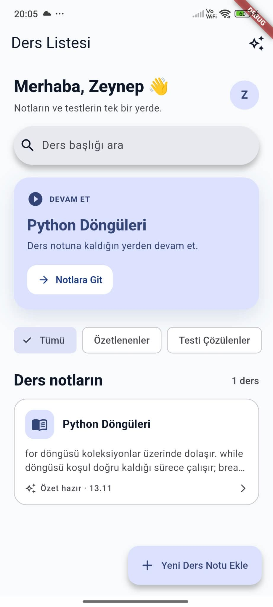
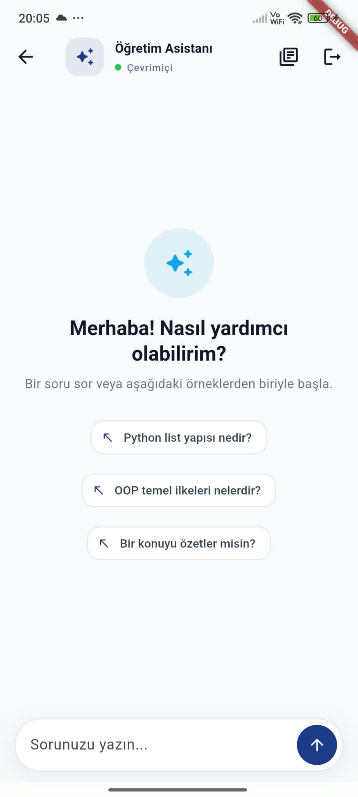
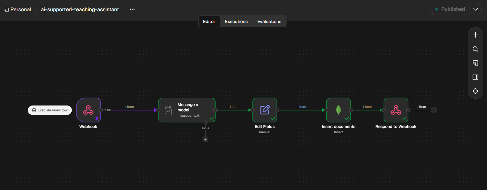
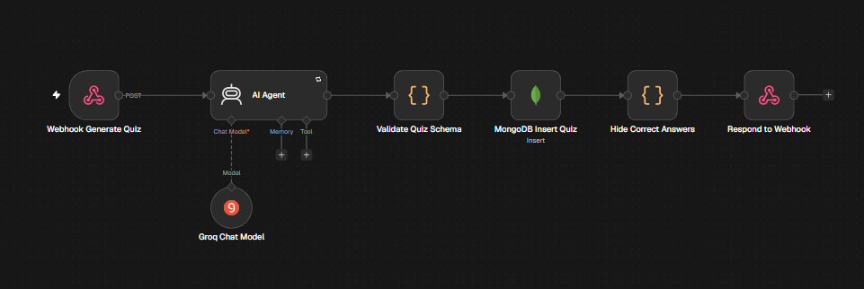
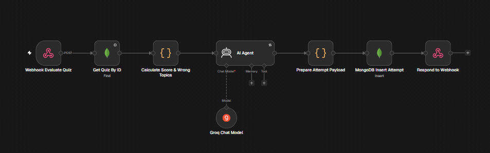
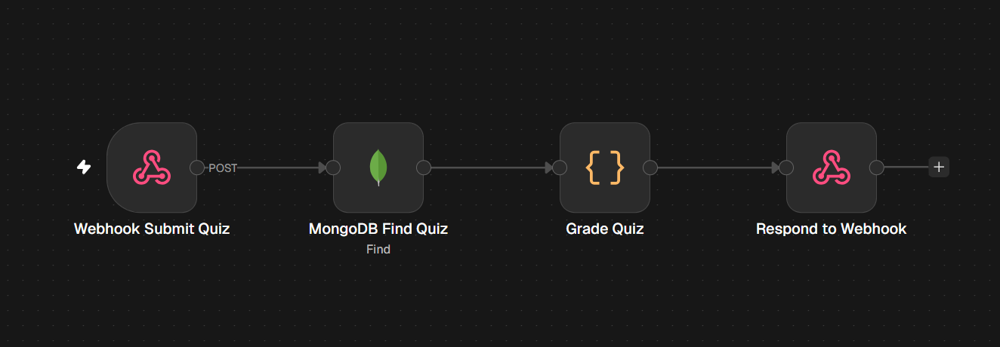

# Akıllı Ders Asistanı (Smart Course Assistant)

Yapay zeka destekli, **Flutter**, **n8n** iş akışları, **Groq** ve **MongoDB** tabanlı uçtan uca akıllı ders ve soru-cevap asistanı.

---

## Proje Yapısı

- `../screenshots/` — Uygulama arayüzü ve n8n iş akışı ekran görüntüleri
- `../*.json` — Dışa aktarılan n8n iş akışları
- `../docker-compose.yml` — n8n ve MongoDB servis yapılandırmaları
- `../start-ai.bat` — Docker servislerini başlatan otomasyon betiği

---

## Ekran Görüntüleri

### Mobil Arayüz (Flutter)

<!-- markdownlint-disable MD033 -->
| Ana Sayfa | Öğretim Asistanı |
| :---: | :---: |
|  |  |
<!-- markdownlint-enable MD033 -->

---

## n8n Otomasyon İş Akışları

Yapay zeka işlemleri n8n webhook'ları üzerinden **Groq** ile yürütülür; kalıcı veriler **MongoDB** üzerinden yönetilir.

| İş Akışı | Endpoint (POST) | Görevi | MongoDB Koleksiyonu |
| :--- | :--- | :--- | :--- |
| ai-supported-teaching-assistant | `/webhook/ask` | Groq ile soru-cevap ve sohbet geçmişi | `chat_history` |
| Summarize Course Notes | `/webhook/summarize` | Ders notunu özetler | `sources` |
| Generate Quiz | `/webhook/generate-quiz` | Metinden çoktan seçmeli soru üretir | `quizzes` |
| Evaluate Quiz | `/webhook/evaluate` | Puanlar ve Groq ile çalışma önerisi üretir | `quizzes`, `quiz_attempts` |
| Submit Quiz | `/webhook/submit-quiz` | Yapay zekâsız hızlı puanlama | `quizzes` |

### 1. Soru-Cevap (ai-supported-teaching-assistant)

Webhook → AI Agent (Groq) → Edit Fields → Insert documents (MongoDB) → Respond to Webhook



Flutter sohbet ekranından gelen soru Türkçe yanıtlanır; soru ve yanıt `chat_history` koleksiyonuna kaydedilir.

### 2. Ders Notu Özetleme (Summarize Course Notes)

Webhook → AI Agent (Groq) → Prepare Source Document → MongoDB Insert Source → Respond to Webhook



Gelen ders notu kısa bir özet ve "Anahtar Kavramlar" listesi olarak özetlenir. Not, özet ve oluşturulma zamanı `sources` koleksiyonuna kaydedilir; yanıt olarak `source_id` ve özet döner.

### 3. Otomatik Test Oluşturma (Generate Quiz)

Webhook → AI Agent (Groq) → Validate Quiz Schema → MongoDB Insert Quiz → Hide Correct Answers → Respond to Webhook


Ders notundan 5 çoktan seçmeli soru üretilir. Modelin JSON çıktısı kod node'u ile temizlenip doğrulanır, `quizzes` koleksiyonuna kaydedilir. Uygulamaya dönen yanıttan doğru cevaplar çıkarılır.

### 4. Performans Değerlendirme (Evaluate Quiz)

Webhook → Get Quiz By ID → Calculate Score & Wrong Topics → AI Agent (Groq) → Prepare Attempt Payload → MongoDB Insert Attempt → Respond to Webhook



Öğrencinin cevapları MongoDB'deki test ile karşılaştırılır; puan, doğru/yanlış sayısı ve yanlış sorular hesaplanır. Groq kişiselleştirilmiş çalışma önerisi üretir ve sonuç `quiz_attempts` koleksiyonuna kaydedilir.

### 5. Hızlı Puanlama (Submit Quiz)

Webhook → MongoDB Find Quiz → Grade Quiz → Respond to Webhook



Yapay zekâ kullanmayan, daha hafif puanlama akışıdır. Testi bulur, cevapları kontrol eder ve puanı döndürür.

---

## Kurulum ve Çalıştırma

### 1. Ortam Değişkenleri

Proje kök dizininde örnek ortam değişkenlerini `.env` dosyasına kopyalayın ve MongoDB parolasını değiştirin:

```powershell
Copy-Item .env.example .env
```

### 2. Altyapı Servislerini Başlatma

Proje kök dizininde Docker servislerini başlatın veya Windows'ta `start-ai.bat` dosyasını çalıştırın:

```powershell
docker compose up -d
docker compose ps
```

### 3. n8n İş Akışlarını İçe Aktarma

n8n arayüzünde (`http://localhost:5678`) kök dizindeki iş akışı JSON dosyalarını **Import from File** ile içe aktarın. Groq API ve MongoDB credential'larını oluşturup ilgili düğümlerde seçin. MongoDB credential'ında Docker servis adı `mongodb`, port `27017` ve authentication database `admin` kullanın. Tüm iş akışlarını **Publish** edin.

### 4. Flutter Uygulamasını Çalıştırma

```bash
cd frontend
flutter pub get
flutter run
```
